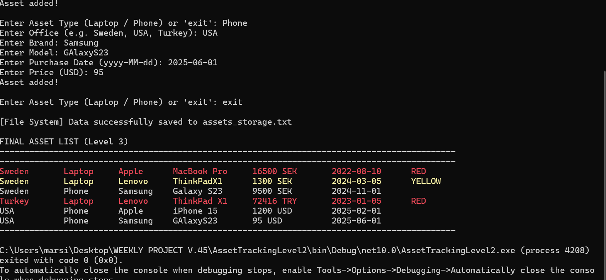
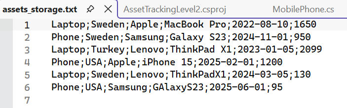

# Asset Tracking System (Week 45 Mini Project)

A clean, modular C# console application designed to track office hardware assets across worldwide corporate locations. This project demonstrates intermediate Object-Oriented Programming (OOP) architectures, data structures, and persistent file-based databases in .NET 8.

## 🚀 Learning Goals Achieved

• Classes \& Objects / Inheritance: Built on a robust abstract base architecture (Asset.cs) extended by specialized sub-classes (Laptop.cs, MobilePhone.cs).

• Polymorphism: Utilizing a unified List\&lt;Asset> collection to seamlessly manipulate, filter, and format different device models simultaneously.

• DateTime Operations: Implemented automated real-time calculation of a 3-year lifespan (36 months) cycle for hardware expiration tracking.

• Basic File Handling: Built an integrated local file synchronization layer (assets\_storage.txt) acting as a persistent flat-file database between runtime sessions.

• Console Formatting: Designed clean tabular outputs using structured string alignment rules alongside real-time business rule telemetry triggers.

───

## 🎨 Asset Lifespan Telemetry (Business Rules)

To optimize IT warehouse management, the terminal dynamically colors rows using strict real-time deadlines calculated against the current calendar day:

• 🟥 RED Status: Asset has less than 3 months (90 days) left of its 3-year lifecycle, or has already expired.

• 🟨 YELLOW Status: Asset has less than 6 months (180 days) remaining of its lifecycle.

• ⬜ Default Text: Asset is stable and modern.

───

## 📋 Table Output Structure

The system automatically tracks financial values using worldwide localization logic (e.g., converting USD entries to local currencies like SEK or EUR depending on warehouse office registration). The output grid formats strictly as follows:

text

Office       Type       Brand      Model           Price           Purchase Date   Status

\--------------------------------------------------------------------------------------------

Sweden       Laptop     Apple      MacBook Pro     16500 SEK       2022-08-10      RED

Sweden       Laptop     Lenovo     ThinkPad X1     13000 SEK       2024-03-15      YELLOW

Sweden       Phone      Samsung    Galaxy S23      9500 SEK        2024-11-01

USA          Phone      Apple      iPhone 15       1200 USD        2025-02-01

───

## 🛠️ 🛠️ How to Build and Run

This project is fully configured for a seamless graphical workspace environment in Visual Studio:

1. Clone or download this repository to your local computer.

2. Open the solution file (.sln) inside Visual Studio 2022 (or later).

3. Ensure that the .NET 8.0 runtime environment is selected.

4. Click on the Green Arrow button (Start / Play) at the top of the interface to build and launch the terminal application.

5. A console window will pop up. To test the persistent backup buffer, type exit into the prompt. The active runtime data will automatically commit to the local assets\_storage.txt database file within the root directory.

# Refactorig GitHub Capilot (plan.txt)
